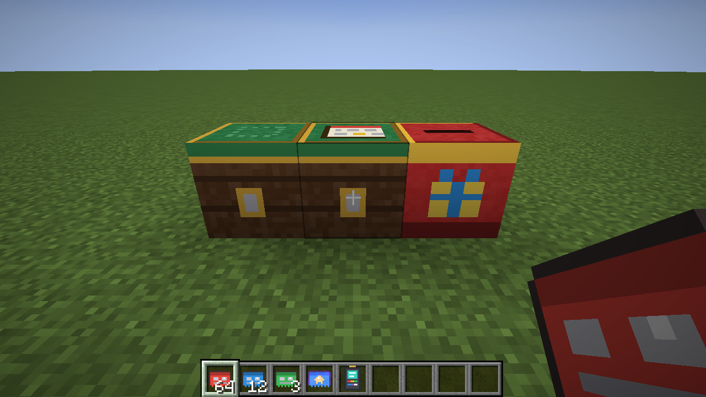
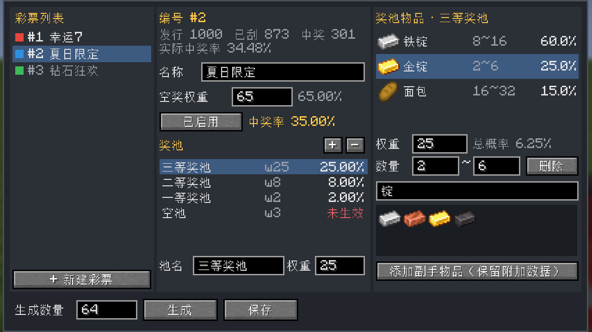
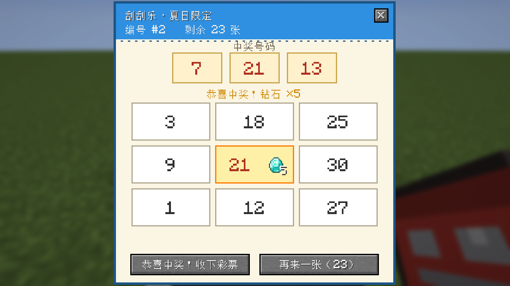
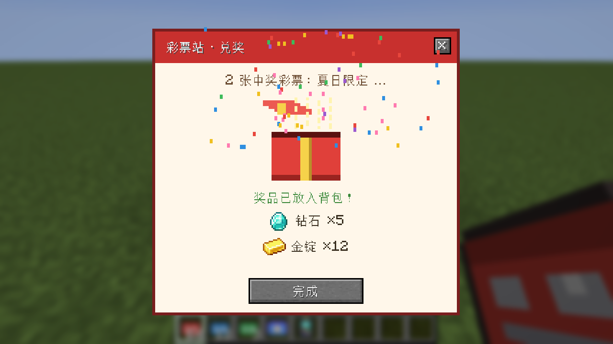

# 刮刮乐彩票 Mod（Lottery-1.21.1）

Minecraft Java 1.21.1 + NeoForge 的服务器刮刮乐彩票系统，由三个互相独立的模块组成，它们之间只通过**服务器台账**联系。

| 模块 | 形态 | 作用 |
|---|---|---|
| **彩票终端** | 手持物品（仅管理员） | 配置彩票种类（编号、名称、奖池、概率），批量生成彩票 |
| **刮奖台** | 方块 | 放入彩票，服务器验证编号后开奖，玩家在界面里刮开 |
| **彩票站** | 方块 | 放入中奖彩票，服务器验证中奖编号后用礼盒发奖 |



## 玩法流程

```
彩票终端 ──生成──▶ 彩票 #编号（同编号可堆叠，无限发行）
                         │ 蹲下 + 右键刮奖台，整组放入
                         ▼
                      刮奖台 ──服务器验证编号、开奖并锁定结果──▶ 刮奖界面
                         ├── 没中奖：点「谢谢参与」，彩票消失
                         └── 中奖：点「恭喜中奖！收下彩票」，得到带唯一中奖编号的中奖彩票
                                         │ 右键彩票站
                                         ▼
                                      彩票站 ──服务器验证中奖编号──▶ 礼盒 ──点开──▶ 奖品进背包
```

### 彩票终端（管理员）
- 右键打开配置界面：左边是彩票列表，中间是名称、空奖权重和奖池，右边是所选奖池里的物品。
- 新建彩票时，服务器在第一次保存时自动分配编号（#1、#2、#3……），编号不会重复。
- 概率分两级归一化：
  - **票级**：空奖权重与各奖池权重一起归一化，决定这张票是空奖还是落进哪个奖池（例如 65 / 25 / 8 / 2 → 中奖率 35%）。
  - **池级**：池内每个物品有自己的权重和数量区间（如 8~16），决定发什么、发多少。
- 物品可以按名称或 ID 搜索（包括其他 Mod 的物品）；也可以「添加副手物品」，会保留物品的附加数据（比如自定义金币）。
- 可以随时「停用」某种彩票，停用后刮奖台拒绝开奖，已发出去的票保留在玩家手里。
- 界面里显示每种彩票的发行数、已刮数、中奖数和实际中奖率。



### 刮奖台
| 操作 | 台子空着 | 台子上有票 |
|---|---|---|
| 空手右键 | 提示「请放入彩票！」 | 打开刮奖界面 |
| 拿着彩票蹲下 + 右键 | 把手上整组彩票放进去 | 同编号的继续放入；编号不同会被拒绝 |
| 空手蹲下 + 右键 | — | 取回还没开始刮的票 |

- 刮奖界面上方是 3 个中奖号码，下方是 3×3 的「我的号码」，和中奖号码相同就算中奖。可以**点击翻开**，也可以**按住左键拖动刮开**，或者点「全部揭开」。
- 台上还有票时，会多一个「再来一张」按钮。
- 谁放的票只有谁能刮，别人使用时提示「正在被 XXX 使用」。



**防刷概率：** 一张票从台上被拿出来的那一刻（打开界面或点「再来一张」），服务器就开奖并锁定结果。按 ESC 或叉号退出、重新登录、断线重连都不会改变结果，重新打开还是同一张票。刮奖台被破坏时，没刮的票掉落，正在刮的票按已锁定的结果处理（中奖彩票掉落，没中奖的直接消失）。

### 彩票站
- 拿着中奖彩票右键：验证这一张。
- 拿着中奖彩票蹲下 + 右键：一次验证背包里所有中奖彩票。
- 验证通过后出现礼盒，点开就把奖品放进背包（背包满了掉在脚下），彩票被回收。
- 谁拿着中奖彩票谁就能兑奖；每个中奖编号只能兑一次。复制出来的票、已经兑过的票、伪造的编号都会被拒绝，并写入告警日志。



## 服务器数据与日志

- **台账**：`<存档>/data/lottery.dat`，保存彩票种类配置、统计数据和每一张中奖彩票的记录（中奖编号、奖品、开奖人、是否已兑奖、兑奖人）。
- **日志**：`<存档>/lottery/logs/lottery-日期.log`，按类别记录：
  - `CONFIG` 配置修改，`ISSUE` 生成彩票，`ROLL` 未中奖，`WIN` 中奖，`REDEEM` 兑奖
  - `WARN` 告警：未知编号、重复兑奖、伪造编号、无权限请求。同一玩家 2 秒内只记一条，防止刷日志。
- **配置**：`<存档>/serverconfig/lottery-server.toml`

| 配置项 | 默认值 | 说明 |
|---|---|---|
| `opPermissionLevel` | 2 | 使用终端、放置或破坏刮奖台和彩票站需要的权限等级 |
| `maxGeneratePerClick` | 1000 | 终端单次最多生成的彩票张数 |
| `numberRange` | 30 | 票面号码从 1~N 中抽取 |
| `useDistance` | 8 | 玩家离方块多远以内，界面操作才有效 |

刮奖台和彩票站只有管理员能放置和破坏，并且免疫爆炸和活塞。

## 安全设计

- 所有抽奖都在服务器上进行，客户端只负责显示，修改客户端改变不了结果。
- 刮奖、兑奖相关的请求都会校验距离、归属和回合编号，重复发送的请求会被忽略（幂等）。
- 终端的每个请求都会重新检查管理员权限。

## 开发

```bash
./gradlew build              # 构建，产物在 build/libs/lottery-<版本>.jar
./gradlew runClient          # 启动开发客户端
./gradlew runServer          # 启动开发服务器
./gradlew runGameTestServer  # 跑自动化测试（无界面服务器）
```

`src/gametest` 里的测试覆盖：中奖率与奖池概率、票面号码规则、放票→开奖→重开不重抽→领取→兑奖的完整流程、重复兑奖与伪造编号、没中奖的票消失、混放不同编号、破坏刮奖台时的掉落。这些测试不会打包进模组 jar。

贴图都是占位用的像素图（`src/main/resources/assets/lottery/textures`），可以直接替换成你们自己的美术资源。
