# 刮刮乐彩票 Mod（Lottery-1.21.1）

Minecraft Java 1.21.1 + NeoForge 的服务器刮刮乐彩票系统，由三个互相独立的模块组成，它们之间只通过**服务器台账**联系。

| 模块 | 形态 | 作用 |
|---|---|---|
| **彩票终端** | 手持物品（仅管理员） | 配置彩票种类（编号、名称、奖池、概率），批量生成彩票 |
| **刮奖台** | 刮奖柜台（1 格） | 放入彩票，服务器验证编号后开奖，玩家在界面里刮开 |
| **彩票站** | 立式兑奖机（1 宽 × 0.5 厚 × 2 高） | 放入中奖彩票，服务器验证中奖编号后用礼盒发奖 |


## 玩法流程

```
彩票终端 ──生成──▶ 彩票 #编号（同编号可堆叠，无限发行）
                         │ 蹲下 + 右键刮奖台，整组放入
                         ▼
                      刮奖台 ──服务器验证编号、开奖并锁定结果──▶ 刮奖界面
                         ├── 没中奖：点「谢谢参与」，彩票消失
                         └── 中奖：点「恭喜中奖！收下彩票」，得到带唯一中奖编号的中奖彩票
                                         │ 右键彩票站
                                         ▼
                                      彩票站 ──服务器验证中奖编号──▶ 礼盒 ──点开──▶ 奖品进背包
```

### 彩票终端（管理员）
- 右键打开**终端菜单**，分三个入口，一般按顺序配置：
  1. **卡券设置**：抽卡用的券（见下文「卡券」）。
  2. **奖池设置**：可复用的奖池。每个奖池有名称、**稀有度**（普通、优良、稀有、史诗、传说、神话）和奖品列表（每件奖品有权重和数量区间，如 8~16）。同一个奖池可以被多个卡池引用，改一次所有用到它的卡池同步生效；正在被使用的奖池不能删除。
  3. **卡池设置**：彩票 / 卡池本身，分「基本信息 / 奖池 / 玩法 / 上架」四个页签。「奖池」页签只负责从全部奖池里点选要用哪些、各给多少权重，奖品在奖池设置里改。
- 新建卡池或奖池时，服务器在第一次保存时自动分配编号（#1、#2、#3……），编号不会重复。
- 概率分两级归一化（每一抽都按这个规则独立抽取）：
  - **票级**：空奖权重与各奖池权重一起归一化，决定这一抽是空奖还是落进哪个奖池（例如 65 / 25 / 8 / 2 → 单抽中奖率 35%）。奖池权重属于卡池，同一个奖池在不同卡池里可以给不同权重。
  - **池级**：池内每个物品有自己的权重和数量区间，决定发什么、发多少。
- 稀有度、玩法、保底稀有度、卡券这类选项都是「◀ 值 ▶」，点过头了点 ◀ 退回一格即可。
- 物品可以按名称或 ID 搜索（包括其他 Mod 的物品）；也可以「添加副手物品」，会保留物品的附加数据（比如自定义金币）。
- 从旧版本升级时，每种彩票里原来的奖池会自动转成共享奖池，命名为「彩票名·池名」，概率不变。
- 可以随时「停用」某种彩票，停用后刮奖台拒绝开奖，已发出去的票保留在玩家手里。
- 界面里显示每种彩票的发行数、已刮数、中奖数和实际中奖率。


#### 玩法（「玩法」页签）

每种彩票可以选一种玩法，并单独设置抽数和保底。开奖结果全部由服务器决定，玩法只影响展示方式。

| 玩法 | 可配置 | 表现 |
|---|---|---|
| **对号刮奖** | 抽数（1~10，不超过格子数）、中奖号码个数（1~5）、网格列×行（最大 10×5）、号码范围（0 = 用服务器默认） | 刮开涂层，「我的号码」和中奖号码相同即中奖；每个中奖的抽占一个格子 |
| **开箱转盘** | 抽数（1~5，每抽一条转盘）、转动秒数（2~15） | 物品条横向滚动、逐渐减速，停在指针处；陪衬物品按真实概率从奖池抽取 |
| **卡牌抽卡** | 抽数（1~10，比如十连）、每行张数、稀有卡特效开关 | 点击翻牌或「全部翻开」逐张翻；开启特效时，史诗及以上的卡在翻开前会发出稀有度颜色的光并抖动 |

**保底**（两种都可选，默认关闭）：
- **连续保底**：设置「保底 N 抽必出 X」。同一玩家在同一种彩票上，连续 N−1 抽都没出 X 及以上稀有度，第 N 抽就必定从 X 及以上的奖池里出。计数按玩家、按彩票存在服务器台账里，换台子、重新登录都不会清零。
- **单票保底**：多抽的票（比如十连）每张至少一个 X 及以上的奖品；如果十抽都没有，会随机把其中一抽换成保底奖品。
- 没有对应稀有度的奖池时，保底不会生效，终端会用红字提示。

右侧的「票面预览」会实时显示票面布局、单抽中奖率、整张中奖率、每张期望奖品数和保底说明。

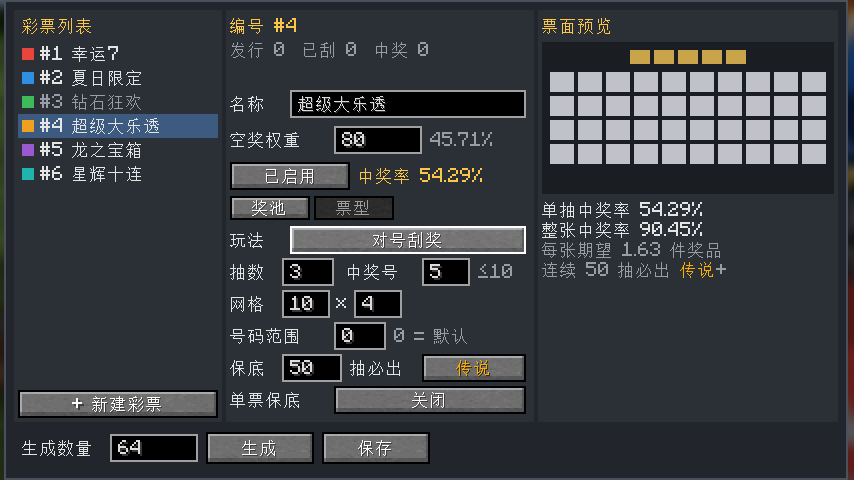

一张票抽中多个奖时，只会得到**一张中奖彩票**，里面记录全部奖品，在彩票站一次兑完。

#### 开奖动画

- **通用**：票面打开时弹出入场；中奖后弹出「开奖结果」汇总，按稀有度从高到低逐个列出奖品，可以点「看票面」切回票面。
- **对号刮奖**：刮的时候涂层碎屑飞溅；中奖格子用流动虚线连到对应的中奖号码；刮完后盖上「中奖 / 未中奖」印章。
- **开箱转盘**：宝箱抖动、白光一闪后开始转；停下时略过头再回弹；史诗及以上有光柱，传说及以上全屏闪光。
- **卡牌抽卡**：卡牌从牌堆飞出发牌；稀有卡翻开前光柱蓄力；全部翻开后最高稀有度的那张放大展示。

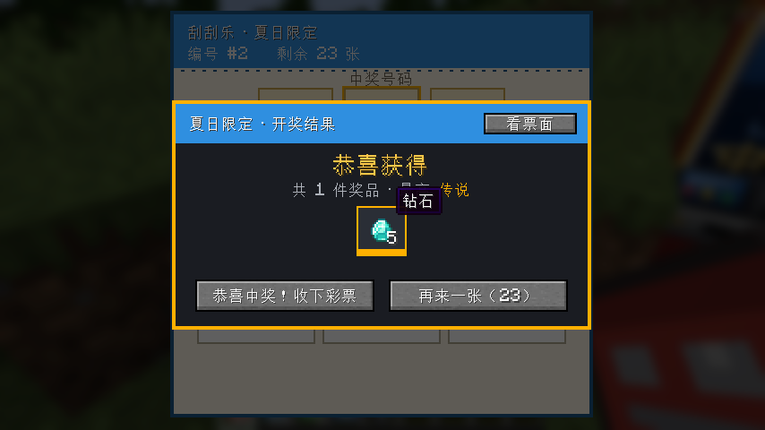

| 10×4 对号刮奖（3 抽） | 开箱转盘（3 抽） | 卡牌十连抽 |
|---|---|---|
| 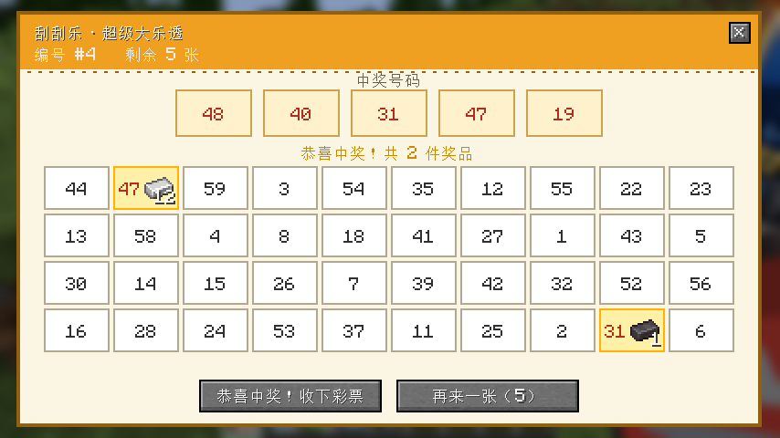 | 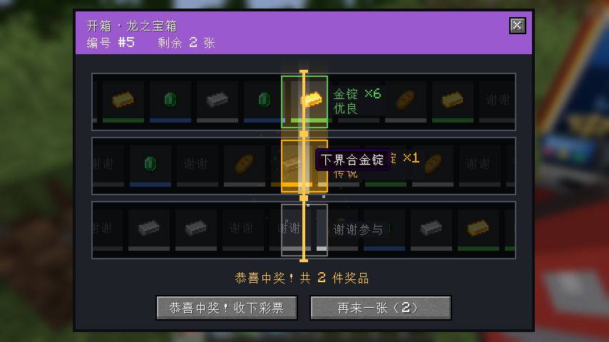 | 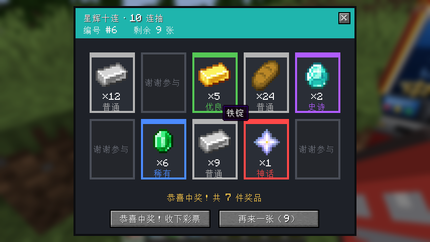 |

### 刮奖台
- 外形是彩票店里的刮奖柜台：22.5° 斜面绿毡写字台，前沿金色挡边，台面上放着一枚刮奖币；下面是木柜，正面有「废票回收」投放口。放置时正面朝向放置的人。
- 台上有票时，台面上会显示一张彩票。

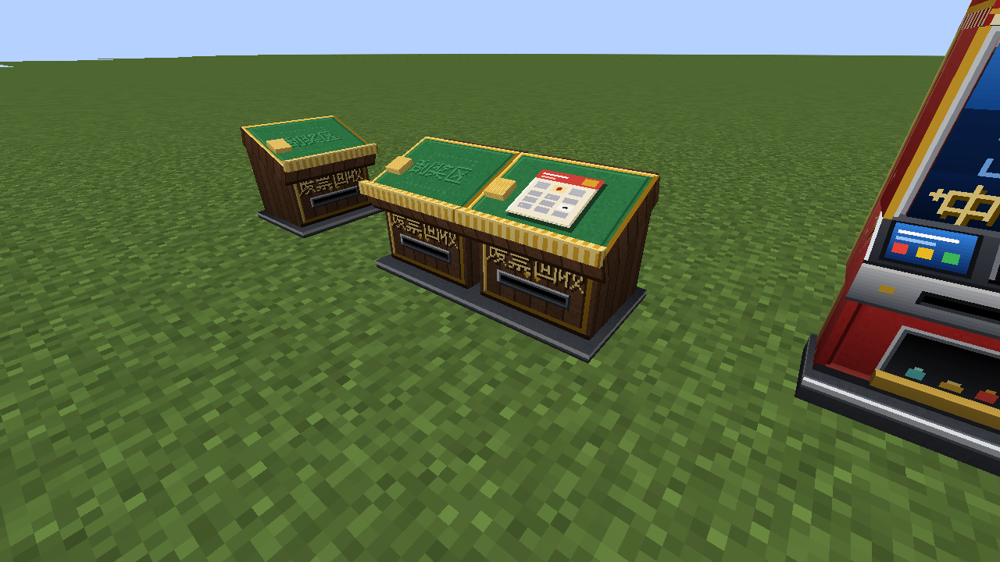

| 操作 | 台子空着 | 台子上有票 |
|---|---|---|
| 空手右键 | 提示「请放入彩票！」 | 打开刮奖界面 |
| 拿着彩票蹲下 + 右键 | 把手上整组彩票放进去 | 同编号的继续放入；编号不同会被拒绝 |
| 空手蹲下 + 右键 | — | 取回还没开始刮的票 |

- 刮奖界面上方是 3 个中奖号码，下方是 3×3 的「我的号码」，和中奖号码相同就算中奖。可以**点击翻开**，也可以**按住左键拖动刮开**，或者点「全部揭开」。
- 台上还有票时，会多一个「再来一张」按钮。
- 谁放的票只有谁能刮，别人使用时提示「正在被 XXX 使用」。


**防刷概率：** 一张票从台上被拿出来的那一刻（打开界面或点「再来一张」），服务器就开奖并锁定结果。按 ESC 或叉号退出、重新登录、断线重连都不会改变结果，重新打开还是同一张票。刮奖台被破坏时，没刮的票掉落，正在刮的票按已锁定的结果处理（中奖彩票掉落，没中奖的直接消失）。

### 彩票站
- 外形参照现实中的自助兑奖机：1 格宽、半格厚、2 格高。
  - 上半层：顶部「彩票兑奖」灯箱，下面是大屏幕（自助兑奖 / 扫码示意 / 中奖即兑）。屏幕和灯箱自发光，夜里也很显眼。
  - 下半层：45° 斜面操作台（小触摸屏、扫码窗、插票口和指示灯），台面前沿是出票口，下面是内收的柜体，有门板、锁孔和领奖口。
- 放置时正面朝向放置的人，像门一样需要上方留出 1 格空间；破坏上下任意一半整台都会拆掉，只掉落 1 个。

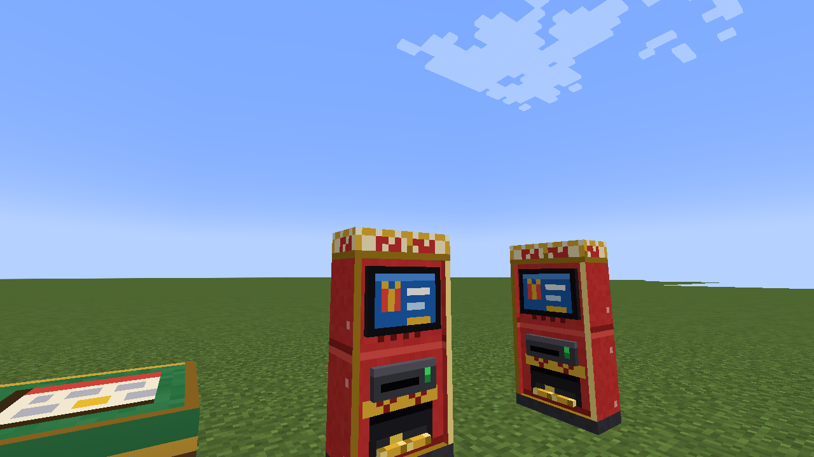
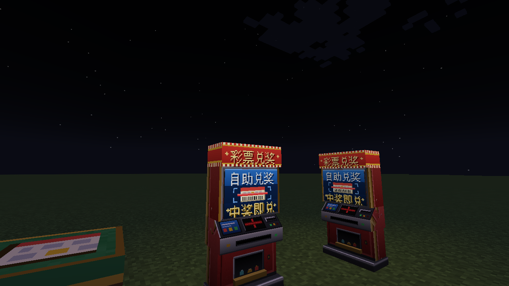

- 拿着中奖彩票右键：验证这一张。
- 拿着中奖彩票蹲下 + 右键：一次验证背包里所有中奖彩票。
- 验证通过后出现礼盒，点开就把奖品放进背包（背包满了掉在脚下），彩票被回收。
- 谁拿着中奖彩票谁就能兑奖；每个中奖编号只能兑一次。复制出来的票、已经兑过的票、伪造的编号都会被拒绝，并写入告警日志。


## 卡池与卡券（二游式抽卡）

除了「发实体彩票 → 刮奖台」，任何一种彩票都可以**上架成卡池**：玩家用**卡券**直接在卡池界面里抽，不用预先生成彩票，数量不限。

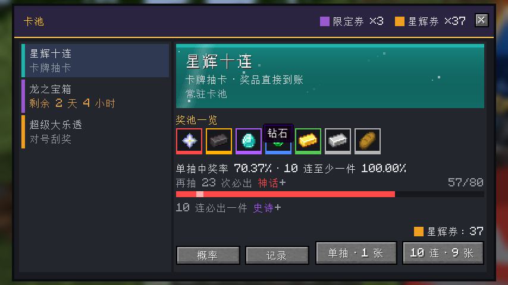

### 卡券
- 新道具「卡券」，可以有多种（例如星辉券、限定券），每种有自己的名字和颜色，同种可以堆叠。
- 管理员在彩票终端菜单的「**卡券设置**」里新建卡券、设置颜色、生成卡券。
- **在模块商店出售**：手拿卡券，到模块商店的购物城后台添加并设置星币价格即可，玩家就能用星币购买。不需要额外配置。

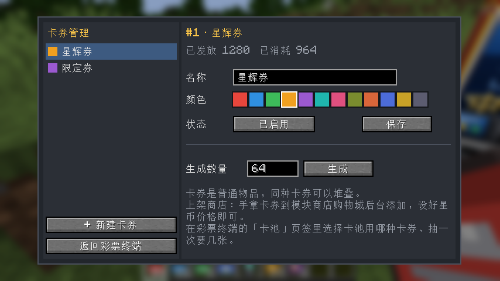

### 上架抽卡（卡池设置 →「上架」页签）
| 设置 | 说明 |
|---|---|
| 上架到卡池 | 打开后这种彩票出现在卡池界面 |
| 卡券 | 抽这个卡池消耗哪种卡券 |
| 单抽 / 多抽 | 单抽要几张卡券；多抽一次抽几次、要几张（比如 10 连 9 张），0 = 关闭多抽 |
| 开始 / 结束 | 限时卡池，格式 `2026-01-01 00:00`，留空不限；到期自动下架 |
| 每周 | 只在某几天开放（例如「今日卡池」轮换），都不选 = 每天 |
| 发放 | 奖品直接进背包，或者发中奖票去彩票站兑奖 |

玩法（对号刮奖 / 开箱 / 抽卡）、奖池、保底都沿用这种彩票原来的设置；保底计数和刮奖台共用。

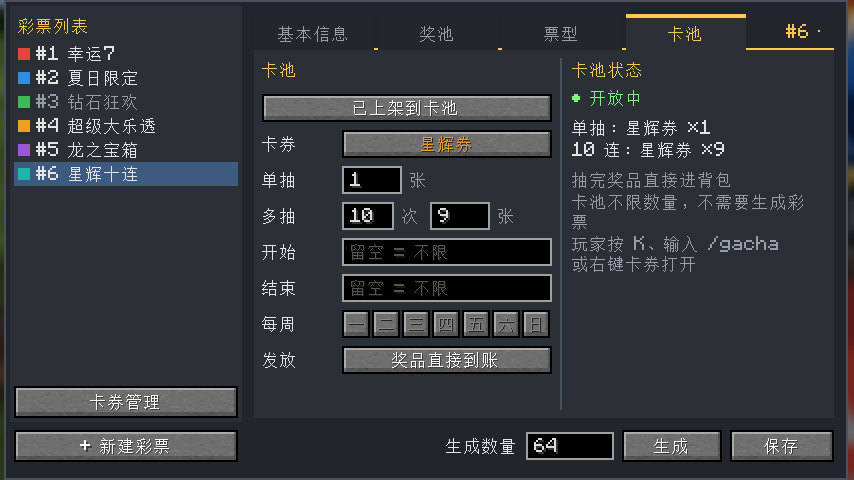

### 玩家怎么抽
- 按 **K**（可在按键设置里改）、输入 **`/gacha`**，或**右键卡券**，在任何地方打开卡池。
- 左边是开放中的卡池（限时卡池会显示剩余时间），右边是卡池介绍、奖品一览、保底进度和「单抽 / N 连」按钮。
- 「概率」按钮显示**概率公示**（每个奖池和每个物品的实际概率），「记录」按钮显示自己最近 100 次**抽卡记录**。
- 点抽卡后，服务器先扣卡券、开奖并锁定结果，然后播放对应玩法的开奖动画。中途关掉、掉线、服务器重启都不会重抽；重新打开卡池会继续这一抽。结果页可以「再抽一次」。

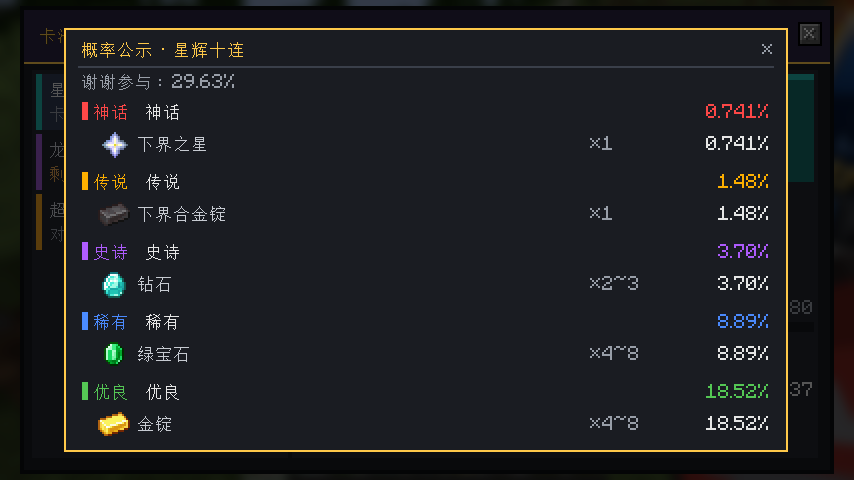

### 抽卡特效
- **卡券飞入**：点抽卡后，卡券从右上角的余额处沿弧线飞进按钮，落下时有音效。
- **召唤预兆**：每一抽一颗流星，从四面八方沿弧线一颗接一颗撞进中心，稀有度从低到高出场，音高逐级上升，中心能量球越来越大；最后一颗之前画面变暗、屏息停顿，最稀有的那颗压轴撞击（灰、蓝、紫、金、红对应稀有度），出传说或神话时整个天空染色。单抽会先来 5 颗银白色流星打节拍。右下角可以「跳过」。
- **十连展示墙**：多抽的结果排成一排竖卡，按稀有度依次滑入亮起。史诗及以上带光柱，传说及以上有脉动光晕；底部的小点表示稀有度等级。
- **NEW 标记**：服务器记录每个玩家从卡池拿到过的物品，第一次抽到的打上 NEW 角标，并有额外音效。
- **卡池界面**：横幅上有扫光；保底进度条上有流光，快到保底时会发光闪烁。
- **神话降临**：抽卡玩法里点到神话卡时不翻牌，直接播放全屏专属演出，结束后这张卡已经翻开；刮奖和开箱在揭开神话奖品后播放。演出内容：黑场和心跳声 → 红色裂光横向撕开、向上下展开 → 奖品从翻涌的红光中放大登场 → 逐字打出物品名。多件神话会逐件展示，可以跳过，结束后进入结果汇总。
- 召唤结束后照常播放这种玩法的开奖动画（刮奖、开箱、翻牌），最后是结果页。

| 召唤 | 十连展示墙 |
|---|---|
| 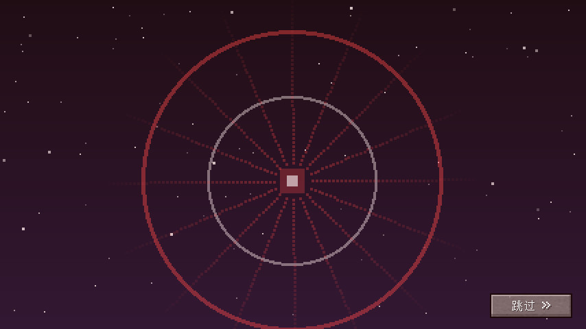 | 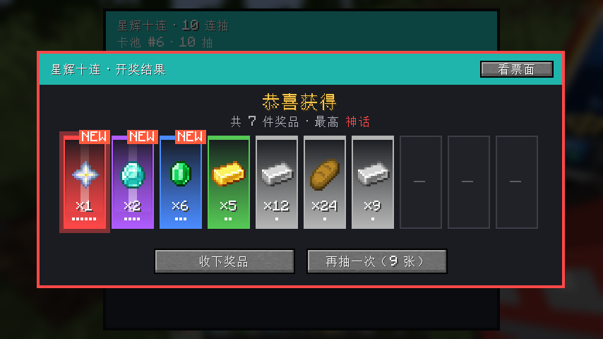 |

## 服务器数据与日志

- **台账**：`<存档>/data/lottery.dat`，保存彩票种类配置（含票型、保底和卡池设置）、卡券种类、统计数据、每个玩家的保底计数、未领取的卡池抽卡和抽卡记录，以及每一张中奖彩票的记录（中奖编号、全部奖品、开奖人、是否已兑奖、兑奖人）。
- **旧存档兼容**：旧版本保存的彩票自动按「3×3 对号刮奖、1 抽、无保底」读取，奖池稀有度为「普通」；旧的单奖品中奖记录和台上正在刮的票也能正常读取和兑奖。
- **日志**：`<存档>/lottery/logs/lottery-日期.log`，按类别记录：
  - `CONFIG` 配置修改，`ISSUE` 生成彩票或卡券，`ROLL` 未中奖，`WIN` 中奖，`PULL` 卡池抽卡（含消耗的卡券），`DELIVER` 卡池奖品到账，`REDEEM` 兑奖
  - `WARN` 告警：未知编号、重复兑奖、伪造编号、无权限请求。同一玩家 2 秒内只记一条，防止刷日志。
- **配置**：`<存档>/serverconfig/lottery-server.toml`

| 配置项 | 默认值 | 说明 |
|---|---|---|
| `opPermissionLevel` | 2 | 使用终端、放置或破坏刮奖台和彩票站需要的权限等级 |
| `maxGeneratePerClick` | 1000 | 终端单次最多生成的彩票张数 |
| `numberRange` | 30 | 对号刮奖的默认号码范围（1~N）。彩票自己设了号码范围时用彩票的；N 小于「中奖号码数 + 格子数」时自动放大 |
| `useDistance` | 8 | 玩家离方块多远以内，界面操作才有效 |

刮奖台和彩票站只有管理员能放置和破坏，并且免疫爆炸和活塞。

## 安全设计

- 所有抽奖都在服务器上进行，客户端只负责显示，修改客户端改变不了结果。
- 刮奖、兑奖相关的请求都会校验距离、归属和回合编号，重复发送的请求会被忽略（幂等）。
- 终端的每个请求都会重新检查管理员权限。

## 开发

```bash
./gradlew build              # 构建，产物在 build/libs/lottery-<版本>.jar
./gradlew runClient          # 启动开发客户端
./gradlew runServer          # 启动开发服务器
./gradlew runGameTestServer  # 跑自动化测试（无界面服务器）
```

`src/gametest` 里的测试覆盖：中奖率与奖池概率、各种网格尺寸下的票面号码规则、多抽概率、连续保底与单票保底、开箱转盘条带、十连抽→一张中奖票→一次兑完所有奖品、旧版本存档读取、放票→开奖→重开不重抽→领取→兑奖的完整流程、重复兑奖与伪造编号、没中奖的票消失、混放不同编号、破坏刮奖台时的掉落、兑奖机上下两半一起拆除且只掉一个。这些测试不会打包进模组 jar。

```bash
./gradlew runDemoClient      # 界面截图：先把任意存档复制到 run/saves/lottery-demo，截图保存在 run/screenshots
```

贴图都是占位用的像素图（`src/main/resources/assets/lottery/textures`），可以直接替换成你们自己的美术资源。
